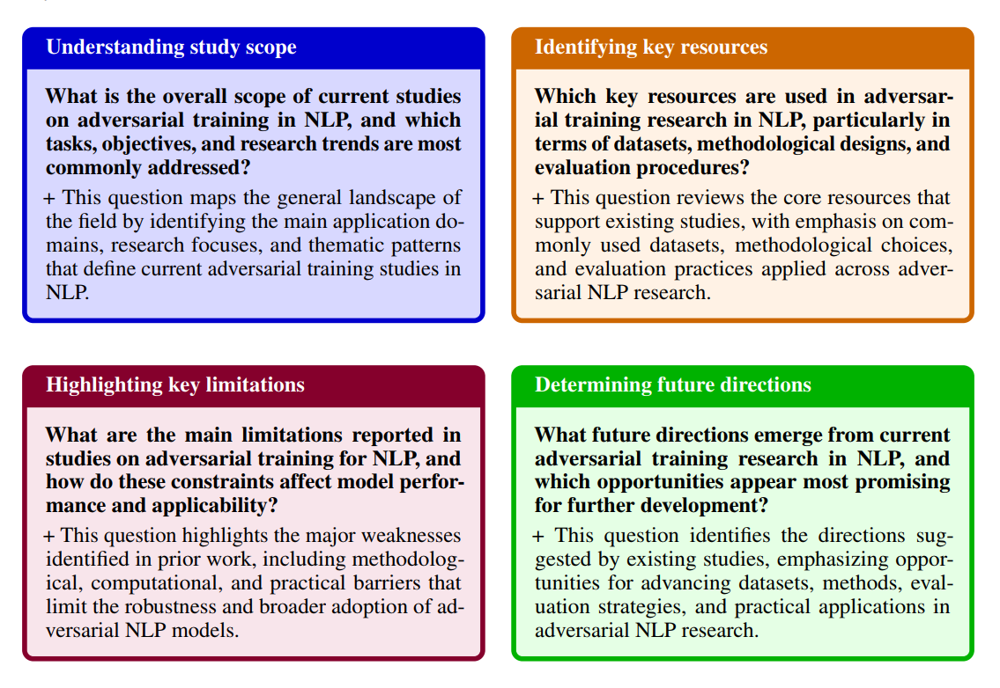
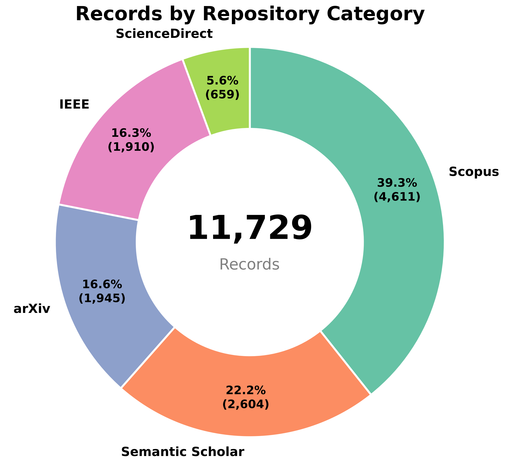
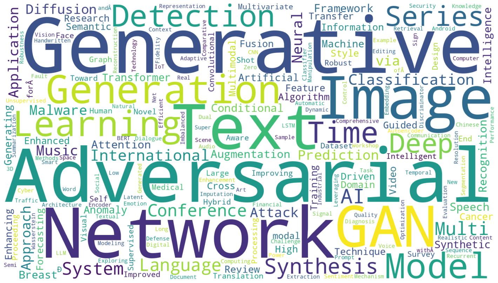
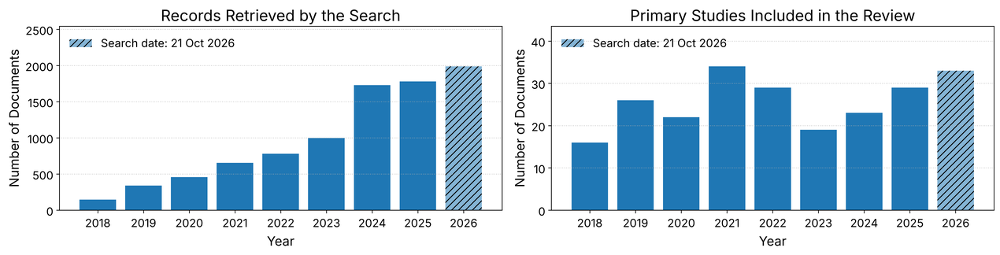
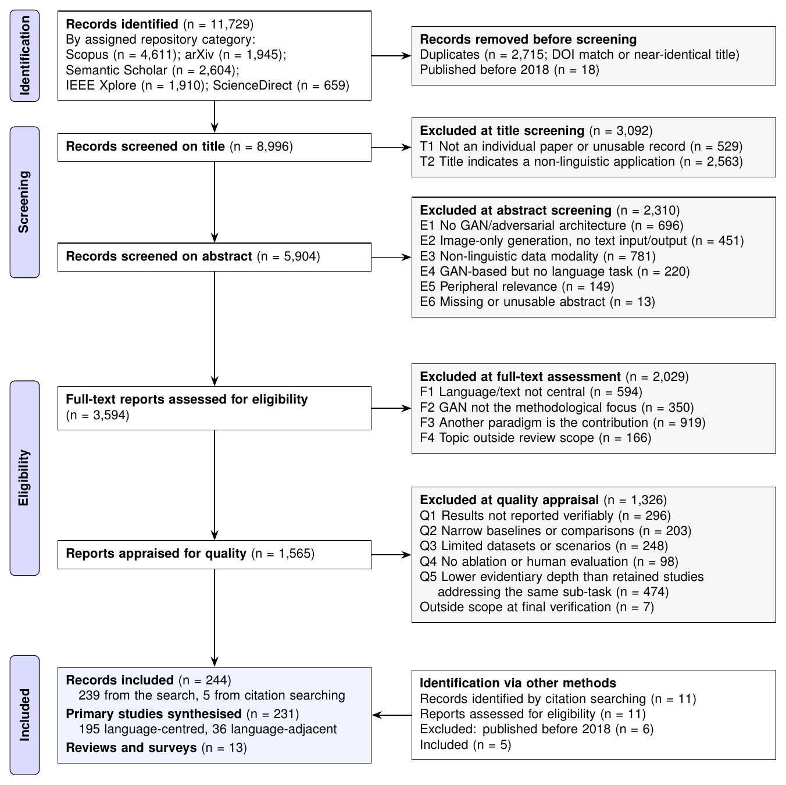
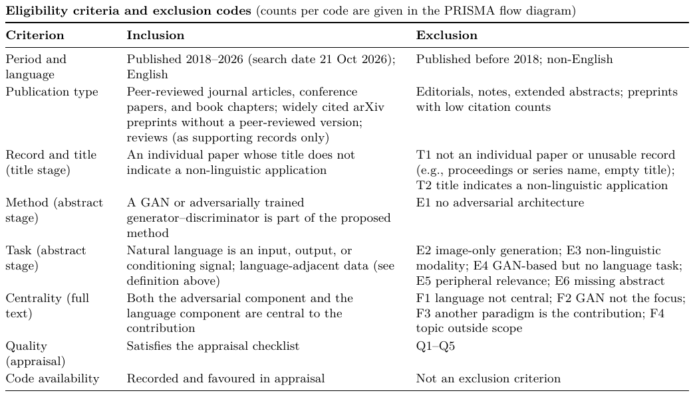
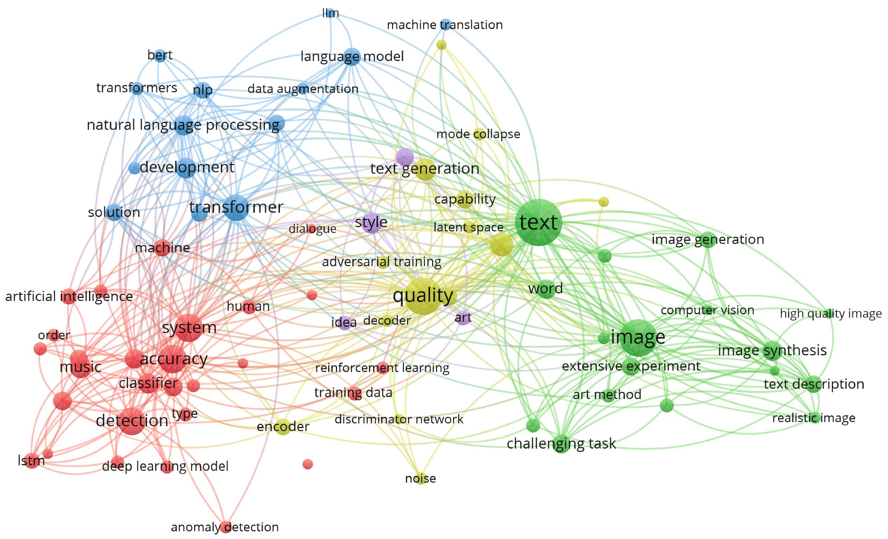

# Generative Adversarial Networks for Natural Language Processing: A Systematic Review, Function-Based Taxonomy, and Research Agenda

**Authors**: Mohammad Hossein Zolfagharnasab* & Amin Haghdadi, Siavash Damari, Hooshiar Zolfagharnasab, Ana F. Sequeira, Jaime S. Cardoso

**Corresponding author**: mohammad.h.zolfagharnasab@inesctec.pt

---

## Repository structure and study objectives

This repository accompanies the systematic review **“Generative Adversarial Networks for Natural Language Processing: A Systematic Review, Function-Based Taxonomy, and Research Agenda.”**  
The review is guided by a set of study objectives defined in the manuscript Introduction and operationalized through a structured set of research questions (RQs).

### Study objectives
The objectives of the review are to:
- Map the landscape of GAN applications in NLP, identifying key architectures and use cases.
- Assess the methodological rigor of existing studies through their evaluation depth and validation.
- Identify gaps in current research to guide future work.


### Research-question blocks
To ensure a transparent link between objectives and analysis, individual research questions are grouped into **RQ blocks**

  

Each RQ block corresponds one-to-one with a study objective and is used to structure the Results and Discussion sections.

---

## 1) Search strategy and literature retrieval

This section explains **where** the literature was retrieved from, and **how** the search queries were constructed to target the intended research space.

### 1.1) Selected Repositories and Rationale

- **Scopus** 
- **Arxiv** 
- **IEEE Xplore** 
- **SemanticScholar**
- **ScienceDirect** 

Equivalent **conceptual search logic** was applied across all repositories, with only syntax-level adaptations.

All retrieved records were merged into a single dataset representing the **PRISMA Identification** stage:

`Prisma/01_aticles_per_source/articles.csv`

The dataset contains title, authors, abstract, year, doi (when available), and Repo. **Repo identifies the repository category assigned to each record.**

---

### 1.2) Keyword design and search intent

The search strategy targets studies at the **intersection of Generative Adversarial Networks and Natural Language Processing**.

Search terms were organized along three complementary dimensions:

  1. Core generative model
     
    GAN, GANs, Generative Adversarial Network, Generative Adversarial Networks

  2. Target application domain

    text, dialogue, music, time series, phishing, malware, sign language

  3. Search refinement criteria

    Publication period: 2018–2026 (search date: 21 October 2026)
    Subject area: Computer Science
    Language: English

Only studies simultaneously addressing all three dimensions were eligible.

### 1.3) Search query

The same query was used for all repositories, adapted only to the syntax of each platform:

```
SEARCH FIELDS: Title, Abstract, Keywords

(
  ("GAN" OR "GANs" OR "generative adversarial network"
   OR "generative adversarial networks")
  AND
  ("text" OR "music" OR "time series" OR "phishing"
   OR "malware" OR "sign language" OR "dialogue")
)
AND (Publication year >= 2018)
AND (Language = "English")
AND (Subject area = "Computer Science")
```

Example of the platform-specific syntax (Scopus):

    TITLE-ABS-KEY ( ( "GAN" OR "GANs" OR "generative adversarial network" OR "generative adversarial networks" ) AND ( "text" OR "music" OR "time series" OR "phishing" OR "malware" OR "sign language" OR "dialogue" ) ) AND PUBYEAR > 2017 AND ( LIMIT-TO ( SUBJAREA , "COMP" ) ) AND ( LIMIT-TO ( LANGUAGE , "English" ) )

The review period starts in 2018 (Publication year >= 2018). The 18 records published before 2018 were removed before screening and are listed in `Prisma/02_duplicate_removal/articles_rejected_by_date.csv`. The search was run on 21 October 2026. Online-first records dated 2027 at the time of the search were screened in the same way; none of them is among the included primary studies.

### 1.4) Citation searching

The reference lists of the included studies and of the related reviews were searched backwards for eligible studies that the database queries had not retrieved. The 11 records found in this way were assessed against the same criteria; 5 were included and 6 were excluded because they were published before 2018. They are listed in `Prisma/08_other_methods/citation_searching_records.csv`.

---

## 2) Analyzing the Retrieved Articles:

### 2.1) Records by assigned repository category

The chart shows how the 11,729 identified records are distributed over the repository categories in the Repo column.



### 2.2) Vocabulary of the retrieved records

The word cloud shows the most frequent terms in the titles of the retrieved records.



### Description

- Frequent terms include Generative, Adversarial, Network, GAN, Image, and Deep.
- Text, Image, Music, Video, and Multimodal also occur often, reflecting the several data modalities among the retrieved records.
- Detection, Classification, Medical, Cancer, and Diagnosis appear as well; many records on such topics were excluded during screening as non-linguistic applications.


---

### 2.3)  Evolution of the literature (2018–2026)

We analyzed the yearly publication trends, after removing duplicate records and records without a valid publication year, to assess the maturity and growth dynamics of the field.



#### Key observations

The left panel counts the de-duplicated records retrieved by the search (`Prisma/02_duplicate_removal/articles_after_duplicates.csv`) per publication year; the right panel counts the primary studies included in the review (`Prisma/07_candidate_papers/candidate_papers.csv`, excluding the 13 supporting reviews and surveys).

De-duplicated records retrieved by the search:

- 2018–2019: Early stage (147–339 records per year)
- 2020–2022: Steady growth (458–780 records per year)
- 2023–2025: Strong expansion (998–1,781 records per year)
- 2026 (partial, through 21st October): 1,988 records, the largest number of any year

Primary studies included in the review:

- 2018–2019: 42 studies, consolidating adversarial text generation
- 2020–2022: 85 studies, spread across all four analytical families
- 2023–2026: 104 studies (29 in 2025 and 33 in 2026), with a growing share of secure text processing and text-guided multimodal applications

---

## 3) PRISMA workflow and screening pipeline

All retrieved records went through the PRISMA 2020 stages below. The repository provides machine-readable screening records and exclusion reasons for each stage.

Identification → Duplicate Removal → Title Screening → Abstract Screening → Full-Text Screening → Qualitative Screening → Inclusion



---

### 3.1) Review Rules and Guidlines

The table below gives the number of records at each PRISMA stage.

| PRISMA stage | Records | Description |
|-------------|---------|-------------|
| Identified | 11,729 | Bibliographic records assembled for screening; by assigned repository category: Scopus 4,611; Semantic Scholar 2,604; arXiv 1,945; IEEE Xplore 1,910; ScienceDirect 659 |
| After removal before screening | 8,996 | Duplicate records removed (2,715); records published before 2018 removed (18) |
| After title screening | 5,904 | Clearly irrelevant or out-of-scope studies excluded |
| After abstract screening (full-text assessed) | 3,594 | Studies failing methodological relevance criteria excluded |
| After full-text screening (quality appraised) | 1,565 | Subset eligible for detailed methodological inspection |
| After quality appraisal | 246 | Studies satisfying the appraisal checklist (Q1–Q5) |
| After final verification | 239 | 7 records outside the GAN-for-NLP scope removed (code S1) |
| Citation searching | 5 | 11 records identified from reference lists, 5 included (6 published before 2018) |
| Final included | 244 | 231 primary studies (synthesised in the review) + 13 reviews and surveys (supporting records) |

Each transition is documented in the CSV files of the corresponding stage.

### 3.2) Eligibility criteria

Explicit eligibility criteria were defined before screening.

#### 3.2.1) Inclusion and exclusion criteria

A study was eligible if a GAN, or a generator–discriminator architecture trained adversarially, was part of its proposed method, and if natural language was central to the task: as input or output text, as spoken or signed language, or as the conditioning signal of a multimodal generator. Studies were published between 2018 and 2026 in English, as peer-reviewed journal articles, conference papers, or book chapters; widely cited arXiv preprints without a peer-reviewed version were also eligible, and reviews were retained as supporting records only. Editorials, notes, extended abstracts, and low-citation preprints were excluded. Public code was **not** an inclusion requirement; code availability was recorded and favoured during quality appraisal.

**Language-adjacent studies.** Studies on non-linguistic data were excluded (code E3), with one exception. A study is *language-adjacent* when its data are not natural language but are modelled with the same adversarial mechanism as a language-centred study of the same sub-task. This covers three kinds of data: (i) symbolic sequences other than language (symbolic music, DNA sequences, malware code); (ii) multivariate time series and network traffic, modelled as sequences of events by anomaly and intrusion detectors; and (iii) language rendered in another medium (scene-text images, recordings of spoken digits). These 36 studies are marked with † in the manuscript and reported separately in all statistics.

**Foundational studies.** Seven foundational studies published in 2017 (SeqGAN, RankGAN, MaliGAN, TextGAN, adversarial REINFORCE, cross-alignment, StackGAN) predate the review period and are not part of the PRISMA corpus. They are listed in the manuscript tables for context, marked with ‡, and excluded from all statistics.



#### 3.2.2) Exclusion codes

Every excluded record carries a single primary reason. For the abstract, full-text and quality stages, the code is stored in the `exclusion_code` and `exclusion_label` columns of the `*_rejected_by_*.csv` and `*_screened_marked.csv` files. For the title stage, reasons beginning with “Removed:” correspond to T1 and reasons beginning with “Title indicates” correspond to T2.

| Stage | Code | Reason | Records |
|---|---|---|---|
| Title | T1 | Not an individual paper or unusable record (e.g., proceedings or series name, retraction notice, empty title) | 529 |
| Title | T2 | Title indicates a non-linguistic application | 2,563 |
| Abstract | E1 | No GAN/adversarial architecture | 696 |
| Abstract | E2 | Image-only generation, no text input/output | 451 |
| Abstract | E3 | Non-linguistic data modality | 781 |
| Abstract | E4 | GAN-based but no language task | 220 |
| Abstract | E5 | Peripheral relevance | 149 |
| Abstract | E6 | Missing or unusable abstract | 13 |
| Full text | F1 | Language/text not central | 594 |
| Full text | F2 | GAN not the methodological focus | 350 |
| Full text | F3 | Another paradigm is the contribution | 919 |
| Full text | F4 | Topic outside review scope | 166 |
| Quality | Q1 | Results not reported verifiably | 296 |
| Quality | Q2 | Narrow baselines or comparisons | 203 |
| Quality | Q3 | Limited datasets or scenarios | 248 |
| Quality | Q4 | No ablation or human evaluation | 98 |
| Quality | Q5 | Lower evidentiary depth than retained studies addressing the same sub-task | 474 |
| Final verification | S1 | Outside GAN-for-NLP scope | 7 |

---

### 4) Stage-wise PRISMA screening details and artifacts

This subsection explains **why each stage exists**, **how decisions were made**, **which studies were excluded**, and **where the evidence for those decisions resides**.

---

#### 4.1) Identification — `Prisma/01_aticles_per_source`

**Rationale**  
The identification stage was designed to favour recall across the relevant research communities.

**What happens here**
- Aggregation of all automated query outputs
- No quality or relevance judgment at this stage

**Artifact**

| File | Description |
|-----|-------------|
| `articles.csv` | All identified records with metadata (title, authors, abstract, year, doi, Repo) |

---

#### 4.2) Duplicate removal — `Prisma/02_duplicate_removal`

**Rationale**  
The same study frequently appears more than once with slight metadata variations. Without explicit duplicate handling, downstream analyses (e.g., trends, distributions) would be distorted.

**How duplicates are detected**
- DOI matching identifies duplicates with high confidence
- Title similarity is used as a fallback for missing or inconsistent DOIs

**Decision principle**
- Only **one canonical record** is retained; when a preprint and its peer-reviewed version were both retrieved, the peer-reviewed record is kept
- Records published before 2018 are removed here, before screening
- No study is excluded for scientific reasons at this stage

**Artifacts**

| File | Description |
|-----|-------------|
| `articles_duplicate_marked.csv` | All detected duplicate groupings |
| `articles_rejected_by_duplicacy.csv` | Records removed due to redundancy (2,715) |
| `articles_rejected_by_date.csv` | Records published before 2018, removed before screening (18) |
| `articles_after_duplicates.csv` | The 8,996 records passed to title screening |

---

#### 4.3) Title screening — `Prisma/03_title_screening`

**Rationale**  
Title screening acts as a **first relevance filter**, removing studies that are unmistakably outside the review’s scope while preserving ambiguous cases.

**Why conservative exclusion is used**
- Titles often underspecify methods
- Overly aggressive filtering risks false negatives

**Typical exclusion logic**

- No GAN/adversarial-network architecture indicated
- No NLP/textual-language or multimodal application dimension
- No demonstrable paper content (junk/non-title entries — proceedings names, citation fragments, bare numbers, retraction or correction notices)

**Artifacts**

| File | Description |
|-----|-------------|
| `articles_title_screened_marked.csv` | Title-level decisions for all 8,996 records passed to screening |
| `articles_rejected_by_title.csv` | The 3,092 excluded records with reasons (T1: 529, T2: 2,563) |
| `articles_after_title_screening.csv` | The 5,904 records retained for abstract screening |

---

#### 4.4) Abstract screening — `Prisma/04_abstract_screening`

**Rationale**  
Abstract screening enforces domain and methodological relevance and formalizes the GAN-for-NLP inclusion criteria used throughout the review.

**Key evaluation questions**
- Is an adversarial-network architecture explicitly described in the methodology?
- Is natural language central as an input, output, or conditioning signal, or does the study meet the language-adjacent definition?
- Is the abstract substantive enough to assess relevance (not missing, corrupted, or a citation/proceedings fragment)?

**Why this stage is critical**
- Excludes studies that mention GANs or language only superficially
- Aligns the corpus with the analytical structure of the review

**Artifacts**

| File | Description |
|-----|-------------|
| `articles_abstract_screened_marked.csv` | Abstract-level decisions |
| `articles_rejected_by_abstract.csv` | Excluded studies with rationale |
| `articles_after_abstract_screening.csv` | Corpus entering full-text review |

---

#### 4.5) Full-text screening — `Prisma/05_fulltext_screening`

**Rationale**  
Focus screening enforces topical centrality and filters out papers where GAN/NLP terminology appears only incidentally rather than as the actual subject.

**Assessment focus**
- Is GAN-based language processing the paper's primary contribution, or a passing mention?
- Does adversarial learning have a substantive methodological role, or is another paradigm (e.g., diffusion, reinforcement learning, or LLMs) the actual contribution?
- Is the language/text or multimodal component central to the work, or a minor detail?

**Why exclusions occur here**
- Abstracts may overstate contributions
- Full text may lack sufficient detail for comparison or synthesis

**Artifacts**

| File | Description |
|-----|-------------|
| `articles_full-text_screened_marked.csv` | Full-text eligibility decisions |
| `articles_rejected_by_full-text.csv` | Excluded studies with explicit reasons |
| `articles_after_full-text_screening.csv` | Studies retained for quality assessment |

---

#### 4.6) Qualitative / quality screening — `Prisma/06_qualitive_fulltext_qualitive`

**Rationale**  
Studies passing full-text screening were assessed using the appraisal dimensions listed below.

**Quality is assessed along multiple axes**
- Methodological rigor (evaluation metrics, comparison against baselines, ablation studies)
- Evidentiary depth (whether claims are backed by concrete numbers vs. asserted qualitatively)
- Dataset and evaluation transparency (single vs. multiple datasets, reported evaluation scope)
- Comparative standing (evaluation depth compared with that of retained studies on the same sub-task)

**Exclusions at this stage**
- Follow the appraisal checklist (Q1–Q5) relative to retained studies on the same sub-task

**Artifacts**

| File | Description |
|-----|-------------|
| `articles_qualitive_screened_marked.csv` | Quality decisions |
| `articles_rejected_by_quality.csv` | Excluded studies with rationale |
| `articles_after_qualitive_screening.csv` | Records retained after quality appraisal |

---

### 4.7) Final inclusion and synthesis artifacts

The included records are listed below.

**Included studies**

| File | Description |
|-----|-------------|
| `Prisma/07_candidate_papers/candidate_papers.csv` | List of the 244 included records (231 primary studies + 13 reviews and surveys), including the 5 records identified through citation searching |
| `Prisma/08_other_methods/citation_searching_records.csv` | Records identified through citation searching, with the decision for each |

---

**Summary**

The repository provides machine-readable screening records and exclusion reasons for each stage.

**Keyword co-occurrence in the retained records**



### Description of the keyword co-occurrence network

The network shows which keywords co-occur in the abstracts of the retained records.

- **Main clusters**
  - NLP foundations: transformer, BERT, language model, NLP, LLM, machine translation
  - Detection/classification: system, accuracy, detection, classifier, LSTM, anomaly detection
  - GAN training & evaluation: adversarial training, discriminator network, latent space, mode collapse, quality
  - Generation/multimodal output: text generation, image synthesis, text description, realistic image
- **Frequent terms shared by several clusters**: text, quality, adversarial training

---

## 5) Repository hierarchy

review paper tree
```
├── README.md
├── figs
│   ├── Distribution_of_Sources.png
│   ├── InclusionExclusion.png
│   ├── prisma.png
│   ├── RQ.png
│   ├── WordCloud_Articles.png
│   ├── graph.png
│   └── years_stats_articles.png
└── Prisma
    ├── 01_aticles_per_source
    ├── 02_duplicate_removal
    ├── 03_title_screening
    ├── 04_abstract_screening
    ├── 05_fulltext_screening
    ├── 06_qualitive_fulltext_qualitive
    ├── 07_candidate_papers
    └── 08_other_methods
```
